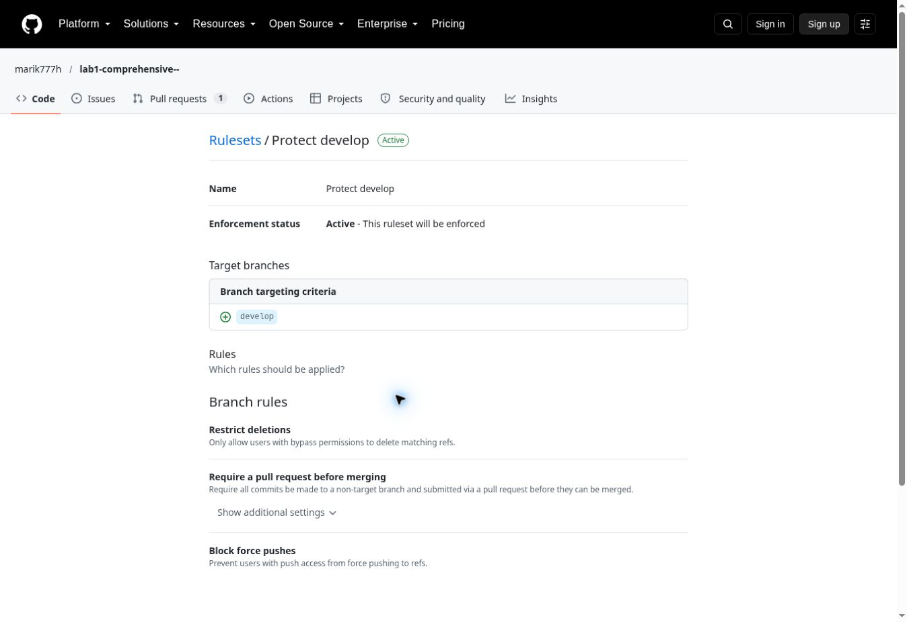
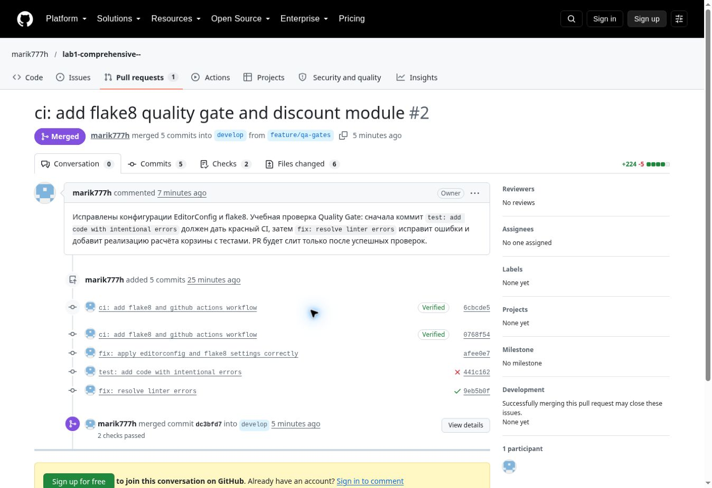
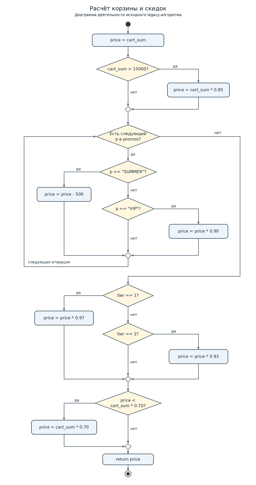

# Итоговый аналитический отчёт по лабораторной работе №1

Дисциплина: Моделирование и анализ программного обеспечения.
Проект: микросервис расчёта корзины и скидок системы лояльности.
Автор: [@marik777h](https://github.com/marik777h).
Дата первоначального выполнения: 16 октября 2026 года.
Последняя проверка: 17 октября 2026 года.

## 1. Резюме

Для хранения транзакций, баллов и промокодов выбрана PostgreSQL по
взвешенной матрице критериев: 4.75 против 3.65 у MongoDB. В публичном
репозитории настроены стандарты оформления, владелец кода и защита develop.
GitHub Actions запускает flake8 и тесты на Pull Request в develop.
На реальном PR воспроизведён переход от ошибки линтера к успешным проверкам.
Реализован расчёт корзины с Decimal, валидацией и тестами; покрытие строк и
ветвлений составляет 100%. Дополнительно 1000 наборов входов проверяются
по независимому точному эталону. Подготовлены UML и план ревью.

Навигация: [выбор СУБД](#2-сравнительный-анализ-технологий),
[контроль версий](#3-архитектура-и-контроль-версий),
[CI и доказательства](#4-инструментальный-контроль-качества),
[UML и ревью](#5-обратное-проектирование-и-планирование-ревью),
[проверка всех требований](docs/requirements-checklist.md).

Инфраструктура и QA слиты в develop. PR с планом ревью оставлен открытым
согласно заданию. Проект представляет учебный расчётный модуль, а не
развёрнутый сервис: подключение БД и проверка прав на промокоды за рамками
реализации этой лабораторной.

## 2. Сравнительный анализ технологий

### 2.1. Матрица принятия решений

Контекст: история операций, начисления и списания баллов, погашение
промокодов должны оставаться согласованными. Шкала: 1 — плохо подходит,
5 — хорошо подходит. Баллы являются экспертной оценкой для этого контекста,
а не результатом нагрузочного тестирования или универсальным рейтингом СУБД.

| Критерий | Вес | PostgreSQL | MongoDB | Вклад PostgreSQL | Вклад MongoDB |
| --- | ---: | ---: | ---: | ---: | ---: |
| ACID и простота транзакций над связанными записями | 0.35 | 5 | 4 | 1.75 | 1.40 |
| Целостность связей и ограничения на уровне БД | 0.25 | 5 | 3 | 1.25 | 0.75 |
| Аудит и аналитические запросы по операциям | 0.15 | 5 | 3 | 0.75 | 0.45 |
| Гибкость схемы акций и атрибутов промокодов | 0.15 | 4 | 5 | 0.60 | 0.75 |
| Простота сопровождения выбранной модели | 0.10 | 4 | 3 | 0.40 | 0.30 |
| **Итого** | **1.00** | | | **4.75** | **3.65** |

Максимальный вес 0.35 у транзакций: нельзя записать покупку, потеряв
соответствующее списание баллов. Вес 0.25 у целостности: важны связи между
пользователями, операциями и промокодами, уникальность ключа операции и
ограничения значений. Вместе эти критерии составляют 60% оценки.
Аудит и гибкость получают по 0.15, сопровождение — 0.10.

### 2.2. Расчёт и обоснование выбора

Формула: `S(СУБД) = Σ(wᵢ × bᵢ)`, где `Σwᵢ = 1.00`, а `bᵢ` — балл 1–5.

```text
PostgreSQL = 0.35×5 + 0.25×5 + 0.15×5 + 0.15×4 + 0.10×4
           = 1.75 + 1.25 + 0.75 + 0.60 + 0.40 = 4.75
MongoDB    = 0.35×4 + 0.25×3 + 0.15×3 + 0.15×5 + 0.10×3
           = 1.40 + 0.75 + 0.45 + 0.75 + 0.30 = 3.65
Разница    = 4.75 − 3.65 = 1.10
```

Выбрана PostgreSQL. Транзакции объединяют связанные изменения, а
FOREIGN KEY, UNIQUE, NOT NULL и CHECK позволяют выразить значительную
часть ограничений модели. SQL подходит для сверок истории операций;
JSONB можно использовать для переменных атрибутов акций.

MongoDB также поддерживает многодокументные транзакции. Более низкая
оценка отражает сложность их применения и сопровождения в выбранной
связанной модели, а не отсутствие ACID. Документоориентированная модель
удобна для изменяющихся атрибутов. При другом профиле данных и нагрузки
веса и баллы следует пересмотреть; показатели скорости здесь не измерялись.

Основание для технических свойств:
[транзакции PostgreSQL](https://www.postgresql.org/docs/16/tutorial-transactions.html),
[ограничения PostgreSQL](https://www.postgresql.org/docs/current/ddl-constraints.html),
[JSON и JSONB](https://www.postgresql.org/docs/current/datatype-json.html),
[транзакции MongoDB](https://www.mongodb.com/docs/manual/core/transactions/).

## 3. Архитектура и контроль версий

### 3.1. Настройка репозитория

Репозиторий: [marik777h/lab1-comprehensive--](https://github.com/marik777h/lab1-comprehensive--),
видимость **Public**. Основная линия лабораторной — develop; main содержит
стартовую документацию и ссылку на отчёт. Рабочие ветки сохранены.

| Ветка | Назначение | Результат |
| --- | --- | --- |
| main | Стартовая точка | README со ссылкой на отчёт |
| develop | Интеграционная линия | Инфраструктура, CI, код, тесты и отчёт |
| feature/infrastructure | EditorConfig и CODEOWNERS | [PR №1](https://github.com/marik777h/lab1-comprehensive--/pull/1) слит |
| feature/qa-gates | Линтер, CI, код и тесты | [PR №2](https://github.com/marik777h/lab1-comprehensive--/pull/2) слит после успешного CI |
| feature/review-plan | План ревью и UML | [PR №3](https://github.com/marik777h/lab1-comprehensive--/pull/3) открыт, не сливать |
| feature/report | Отчёт и подтверждающие материалы | Доставка отчёта в develop через отдельный PR |

Исходные коммиты инфраструктуры сохранены:
[EditorConfig](https://github.com/marik777h/lab1-comprehensive--/commit/4295286)
и [CODEOWNERS](https://github.com/marik777h/lab1-comprehensive--/commit/421ac700631c0ea1a409128b88fef0f7ddb8e669).
История этих коммитов сохранена. Итоговые настройки дополнительно
зафиксированы коммитом
[`chore: setup editorconfig and codeowners`](https://github.com/marik777h/lab1-comprehensive--/commit/f1aed4fe6603b95a5c1711c1505da85fd70407f2).
Ошибка отсутствующей секции `[*]` в EditorConfig
исправлена [отдельным коммитом](https://github.com/marik777h/lab1-comprehensive--/commit/afee0e78f750c7e7508e9f57d7c16eb9cbf8a34a).
Теперь есть `root = true`, UTF-8, LF, отступ в четыре пробела и финальная
новая строка. Для YAML задан стандартный отступ в два пробела.

### 3.2. Контроль доступа

Действует [ruleset Protect develop](https://github.com/marik777h/lab1-comprehensive--/rules/25237735):
статус Active, целевая ветка develop, обязательный PR перед слиянием,
запрет удаления и force push. Это действующая защита через ruleset,
а не отдельное legacy Branch protection rule.



Содержимое [`.github/CODEOWNERS`](.github/CODEOWNERS):

```text
# Default owner for every file in this repository.
* @marik777h
```

CODEOWNERS назначает владельца всех файлов, но само наличие файла не
делает его Approve обязательным. В текущем ruleset количество обязательных
одобрений — 0, `require_code_owner_review` выключен. Автоматические
проверки выполняются, но обязательные status checks в ruleset не заданы;
в этой работе слияния выполнялись после проверки зелёного CI.

В индивидуальной работе нельзя одобрить собственный PR:
[ограничение GitHub](https://docs.github.com/en/pull-requests/how-tos/review-pull-requests/approving-a-pull-request-with-required-reviews).
Поэтому независимый Approve не заявляется как выполненный; для него
необходим второй участник. Обязательность самого PR подтверждена.

## 4. Инструментальный контроль качества

### 4.1. Настройка CI/CD

Workflow: [`.github/workflows/qa.yml`](.github/workflows/qa.yml).
События: `pull_request` в `develop`, `push` в `develop` и ручной запуск.
Это CI-контроль качества;
шагов развёртывания нет. Python 3.12, flake8 7.4.1, coverage 7.16.2.
Права workflow ограничены `contents: read`, время job — пять минут.
checkout и setup-python зафиксированы по SHA проверенных официальных v6.
Git-учётные данные после checkout не сохраняются.

Текущий job `quality` выполняет единый [`scripts/check.py`](scripts/check.py).
Конфигурация [`.flake8`](.flake8)
имеет обязательную секцию `[flake8]` и `max-line-length = 80`.
Скрипт сначала запускает flake8, затем unittest под coverage с учётом
ветвлений и требует минимум 95% — строже исходного критерия >80%.
При первой ошибке следующие этапы не запускаются, код возврата ненулевой.
Локальный запуск и CI используют один скрипт и зафиксированные версии
в [`requirements-dev.txt`](requirements-dev.txt).

Локальное воспроизведение:

```bash
python -m pip install -r requirements-dev.txt
python scripts/check.py
```

### 4.2. Работа Quality Gate

Проверка выполнена в одном [PR №2](https://github.com/marik777h/lab1-comprehensive--/pull/2).

| Состояние | Коммит | GitHub Actions | Результат |
| --- | --- | --- | --- |
| Намеренная ошибка | [`441c162`](https://github.com/marik777h/lab1-comprehensive--/commit/441c162a5e4f3ea9067584e1e4c35b4425eba843), `test: add code with intentional errors` | [Запуск №1](https://github.com/marik777h/lab1-comprehensive--/actions/runs/38903539783) | failure, lint красный |
| Исправление | [`9eb5b0f`](https://github.com/marik777h/lab1-comprehensive--/commit/9eb5b0f1f2dbb66c555a411975cdf7c825925faa), `fix: resolve linter errors` | [Запуск №2](https://github.com/marik777h/lab1-comprehensive--/actions/runs/38903714066) | success, lint и tests зелёные |



Фактические ошибки из лога первого запуска:

```text
./src/discount.py:1:1: F401 'os' imported but unused
./src/discount.py:5:5: F841 local variable 'description' is assigned to but never used
./src/discount.py:5:81: E501 line too long (125 > 80 characters)
Process completed with exit code 1.
```

Неиспользуемый импорт и учебная переменная удалены, все строки ограничены
80 символами. Вместо заглушки добавлена рабочая функция и регрессионные
тесты. На момент демонстрации: 7 тестовых методов, 37 исполняемых выражений,
20 ветвей, пропусков нет, coverage 100%. PR слит коммитом
[`dc3bfd7`](https://github.com/marik777h/lab1-comprehensive--/commit/dc3bfd71612a89127bf968177d382b9105768386).

### 4.3. Дополнительная проверка после выполнения задания

При повторном аудите выявлена зависимость расчёта от traps и диапазона
экспоненты внешнего Decimal-контекста. В предыдущей реализации
`localcontext()` менял только точность и округление. При включённом
`Inexact` или малом `Emax` допустимые входы приводили к исключению.
Исправление ([коммит f2b3385](https://github.com/marik777h/lab1-comprehensive--/commit/f2b3385a59c7abca3eaddfe3d5d6a36b45948de1))
создаёт отдельный Context с заданной точностью и округлением,
изолируя вычисления от активного контекста вызывающей программы.

Добавленные регрессионные тесты воспроизводят оба сбоя на прежней
реализации и проходят на исправленной. Изменений бизнес-порядка скидок нет.
Аннотации типов фиксируют публичный контракт функции.

Текущий результат: **12 тестовых методов, 1000 детерминированных
сценариев с эталоном на Fraction, 36 исполняемых выражений и 20 ветвей,
покрытие 100%**. Эталон использует точные рациональные числа и отдельное
целочисленное округление, а не вызывает реализацию повторно. Также
проверены неизменность списка промокодов и сохранность внешнего контекста
при успешном расчёте и ошибке валидации.

Основание для работы с контекстом и точным эталоном:
[Decimal Context](https://docs.python.org/3.12/library/decimal.html#decimal.Context),
[Fraction](https://docs.python.org/3.12/library/fractions.html).

## 5. Обратное проектирование и планирование ревью

### 5.1. Анализ алгоритма



Редактируемый исходник: [`docs/uml_diagram.drawio`](docs/uml_diagram.drawio),
открывается в diagrams.net. Диаграмма показывает начало и конец, условие
`cart_sum > 15000`, цикл `for p in promos`, ветвления SUMMER/VIP,
уровни tier=1/2 и финальное ограничение `price < cart_sum * 0.70`.
Она описывает исходный legacy-фрагмент; дополнительные проверки входов
и округление реализации не выдаются за часть legacy.

Выявленные проблемы исходного кода:

1. Магические числа 15000, 0.85, 500, 0.90, 0.97, 0.93 и 0.70
   затрудняют проверку правил. В реализации вынесены в константы.
2. Денежные расчёты через float и отсутствие явного округления.
   Использованы Decimal и ROUND_HALF_UP до копеек в конце расчёта.
3. Нет валидации отрицательных сумм, NaN, infinity и типов аргументов.
   Добавлены проверки и понятные исключения.
4. Порядок промокодов влияет на итог: при сумме 10000 и tier=0
   SUMMER→VIP даёт 8550, VIP→SUMMER — 8500. Порядок сохранён и проверен.
5. Повторные промокоды применяются повторно, неизвестные игнорируются.
   Это поведение сохранено для совместимости и отмечено как риск фрода.
6. Вычислительная функция не проверяет владельца, срок и право применения
   промокода. Для реального сервиса нужен отдельный транзакционный контроль.
7. Нет тестов граничных условий и контракта возвращаемого значения.
   Добавлены тесты порога, лимита, денежных значений и ошибочных входов.

Реализация возвращает Decimal с двумя знаками и допускает конечные суммы
от 0 до 999999999999.99, tier=0/1/2 и список либо кортеж строк-промокодов.
Это явное уточнение контракта legacy; при интеграции требуется проверить
вызывающий код и сериализацию Decimal. Изменение правил повторного
применения промокодов требует отдельного согласования.

### 5.2. План code-review

[PR №3 с планом ревью и UML](https://github.com/marik777h/lab1-comprehensive--/pull/3)
оставлен открытым. Файл плана находится
[в ветке feature/review-plan](https://github.com/marik777h/lab1-comprehensive--/blob/feature/review-plan/docs/review-plan.md).
Коммиты:
[`docs: add review plan for discount module`](https://github.com/marik777h/lab1-comprehensive--/commit/0042d9a1252da9d557f3c4df7f1b7fb1024e3ed9)
и [`docs: add UML diagram for discount algorithm`](https://github.com/marik777h/lab1-comprehensive--/commit/ad6d31384719c73c157b75caf844aa47fd960389).
Копия диаграммы опубликована в develop вместе с отчётом, чтобы изображение
отображалось, пока PR с планом остаётся открытым.

Ревью проверяет точность денег, порядок скидок, входные данные и риски фрода.
Критерии плана: 0 ошибок flake8, строки ≤80, именованные бизнес-константы,
успешные граничные и негативные тесты, покрытие >80%.
Текущий CI дополнительно поднимает порог до 95%.
Автор и владелец — @marik777h; независимый ревьюер назначается отдельно.
QA в индивидуальной работе выполняет автор. Спор фиксируется в PR с
конкретным примером; после двух циклов обсуждения его решает преподаватель
или Tech Lead. Денежные и антифрод-споры блокируют промышленный релиз.

## 6. Заключение

Стандарты оформления уменьшают шум в изменениях, защита develop сохраняет
обсуждение изменений через PR, а flake8 обнаруживает дефекты до слияния.
Тесты делают проверяемыми границы, порядок скидок и денежное округление.
UML помогает сопоставить реализацию с исходной логикой; план ревью задаёт
измеримые критерии и порядок разрешения споров.

Перед промышленной эксплуатацией потребуются реализация хранения данных,
контроль прав на промокоды и независимое ревью. Для полного буквального
соответствия оформлению задания остаётся уточнить фамилию автора и
добавить её в название репозитория вместо текущего `lab1-comprehensive--`.
Исторические сообщения двух исходных инфраструктурных коммитов сохранены.

## Контрольный список

- [x] Матрица с пятью критериями, суммой весов 1.00 и расчётами.
- [x] Публичный репозиторий, main, develop и feature-ветки.
- [x] Действующая защита develop с требованием PR через ruleset.
- [x] Корректные .editorconfig, .flake8 и .github/CODEOWNERS.
- [x] Workflow для PR в develop; реальные красный и зелёный запуски.
- [x] src/discount.py, тесты и coverage 100%.
- [x] docs/uml_diagram.png и редактируемый .drawio.
- [x] docs/review-plan.md в feature/review-plan; PR №3 открыт.
- [x] REPORT.md в develop, ссылки и реальные скриншоты GitHub.
- [ ] Фамилия автора в названии репозитория — требуется уточнение.
- [ ] Независимый Approve — требуется другой участник, автор не может одобрить свой PR.
